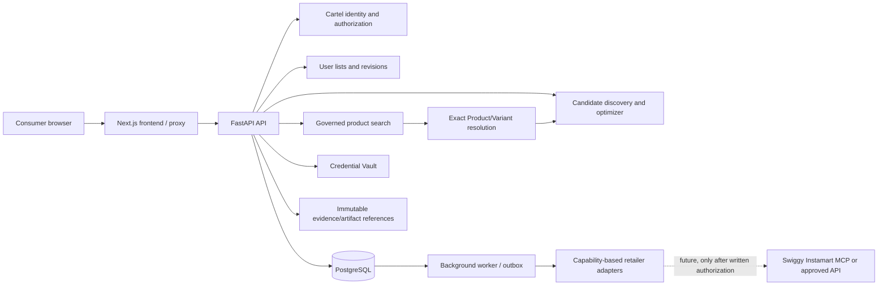

# Cartel Smart Cart Optimizer

## Swiggy Instamart Partnership Readiness Package

**Status:** Ready for internal review only

**Decision:** PARTIALLY READY

Cartel has not received Swiggy commercial authorization, is not a Swiggy partner, has no Instamart adapter, and has no Instamart credentials or production access. Cross-retailer comparison remains unapproved. Production pricing and sustainable zero-cost availability remain unconfirmed.

This package is an application-preparation artifact. It has not been submitted and no Swiggy service was contacted or invoked.

## Executive Brief

Cartel is a consumer grocery comparison and basket-optimization product in active repository development. Its intended workflow is:

1. A consumer states what they need.
2. Cartel resolves an exact governed product and pack configuration.
3. Authorized retailer evidence is collected for the consumer's delivery context.
4. Equivalent products and observed retailer facts are compared.
5. Cartel proposes a basket allocation across supported retailers.
6. The user approves the plan before any retailer cart preparation or checkout handoff.

Cartel's business model is explicitly cross-retailer. It is not merely an Instamart shopping assistant. Any Swiggy relationship would need to authorize comparative display, catalog aggregation, derived recommendations, and the associated storage and retention model.

Swiggy's published production-access rules currently list competitive intelligence or benchmarking as not allowed. That creates a direct policy issue for Cartel and requires a written exception or negotiated enterprise agreement before implementation. [Swiggy production access rules](https://mcp.swiggy.com/builders/access/)

## Verified Product and Architecture

### Implemented in the repository with focused tests

- Next.js consumer frontend with a same-origin/server proxy path.
- FastAPI backend and API route structure.
- PostgreSQL-backed user/authentication and consumer-state models in the current development/runtime work.
- Server-managed sessions and CSRF handling.
- Argon2id password hashing in the backend authentication service.
- OAuth identity architecture for Google/GitHub, with Apple configuration readiness but no enabled Apple callback.
- Owner-scoped retailer connection lifecycle.
- Credential Vault using AES-256-GCM with owner, connection, retailer, secret type, version, and reference bound as associated data.
- Capability declarations, lifecycle authorization, credential resolution, and a shared retailer adapter executor.
- Governed ingestion contracts, immutable artifact references, observation provenance, exact Product/Variant matching, and consumer eligibility gates.
- Product search and basket candidate discovery that exclude inadmissible or unavailable retailer evidence.
- Deterministic cart optimization contracts and explicit unavailable/unresolved outcomes.
- Structured logging, request correlation, PostgreSQL-backed jobs/outbox work, Redis rate limiting, and health/readiness infrastructure from the current runtime foundation.
- Blinkit policy lockdown. Historical evidence is preserved, but acquisition, production ingestion, connection establishment, and consumer eligibility are blocked pending authorization.

Evidence is based on repository implementation and tests, not target architecture documents alone.

### Capability evidence matrix

| Capability | Repository evidence | Classification | Limitation |
|---|---|---|---|
| PostgreSQL persistence | SQLAlchemy models, Alembic migrations, runtime configuration, integration fixtures | `IMPLEMENTED_NOT_FULLY_VERIFIED` | Local/test runtime evidence only; no production deployment evidence |
| Server-managed sessions and CSRF | Authentication service, session models, API dependencies, consumer-auth tests | `IMPLEMENTED_AND_TESTED` | Production cookie/proxy deployment still requires environment validation |
| OAuth identity handling | Google/GitHub provider and callback code, OAuth tests | `IMPLEMENTED_NOT_FULLY_VERIFIED` | No live external-provider credentials or production callback validation |
| Argon2id password hashing | Password service and auth primitive tests | `IMPLEMENTED_AND_TESTED` | Operational password policy and deployment controls remain environment-dependent |
| AES-256-GCM Credential Vault | Vault crypto/key-provider code and vault tests | `IMPLEMENTED_AND_TESTED` | Production key custody is unavailable; the development provider is explicitly not production key management |
| Owner-scoped retailer connections | Connection service, lifecycle, API, migrations, integration tests | `IMPLEMENTED_NOT_FULLY_VERIFIED` | PostgreSQL-backed integration coverage is environment-dependent |
| Adapter capability/lifecycle enforcement | Adapter contracts, executor, lifecycle tests | `IMPLEMENTED_AND_TESTED` | No authorized Instamart adapter exists |
| Governed ingestion/provenance | Acquisition contracts, artifact/observation registries, ingestion tests | `IMPLEMENTED_AND_TESTED` | Filesystem-oriented paths are not proof of production object-storage operation |
| Exact Product/Variant resolution | Catalog, association, resolver, and product-intelligence tests | `IMPLEMENTED_AND_TESTED` | No Instamart evidence has been resolved |
| Consumer eligibility | Product search, candidate discovery, cart resolution, Blinkit lockdown tests | `IMPLEMENTED_AND_TESTED` | Eligibility is only as useful as the available authorized evidence |
| Search and basket optimization | Search services, candidate discovery, optimizer, API/integration tests | `IMPLEMENTED_AND_TESTED` | Current retailer coverage remains limited and checkout evidence is unavailable |
| Redis distributed rate limiting | Redis limiter, configuration, and rate-limit tests | `IMPLEMENTED_NOT_FULLY_VERIFIED` | Local validation is not proof of multi-instance production behavior |
| PostgreSQL-backed background jobs/outbox | Job/outbox models, worker, migrations, and focused tests | `IMPLEMENTED_NOT_FULLY_VERIFIED` | Worker deployment, recovery, and operational monitoring require production validation |
| Audit events and redacted logging | Audit models/services, structured logging, security tests | `IMPLEMENTED_NOT_FULLY_VERIFIED` | No independent security audit or centralized production log review exists |
| Blinkit lockdown | Central policy, legacy-path guards, serving exclusions, regression tests | `IMPLEMENTED_AND_TESTED` | Historical rows remain by design; no authorization exists |

The matrix classifies repository behavior, not commercial approval, production readiness, or external security certification.

### Implemented but incompletely verified for production

- PostgreSQL/Redis/Docker Compose runtime behavior has local validation, but this is not evidence of production scale or external-provider readiness.
- Credential Vault cryptography and lifecycle behavior are implemented, but production KMS/HSM or external secret-manager integration is not present.
- Email, worker, outbox, rate-limit, and operational foundations are present but require deployment-specific configuration and operational ownership.
- The exact end-to-end flow for a newly authorized retailer is unverified because no Instamart adapter or credentials exist.

### Designed or planned, not implemented/operational

- Instamart integration and production credentials.
- Swiggy-specific commercial/data-rights agreement.
- Production KMS/HSM key management.
- Instamart-specific schema mapping, freshness contract, serviceability mapping, and evidence-quality qualification.
- Retailer cart preparation and checkout handoff for Instamart.
- Production compliance approval, external security audit, certification, or formal privacy review.

## Actual Data Flow

The dashed Instamart edge is future-only. No such edge is implemented or active.

## Intended Instamart Data Specification

Subject to Swiggy approval and a documented contract, Cartel would request only the minimum data needed for the supported workflow:

- Stable retailer-native product identity.
- Product title, brand, pack size, quantity, and variant attributes.
- Location/address or coordinate context used for serviceability.
- Observed price and currency.
- Explicit availability/inventory state.
- Capture timestamp or provider freshness metadata.
- Native retailer URL or reference where permitted.
- Structured error or unavailable outcome.

Cartel would not infer identity from title similarity, price, availability, or array position. Product identity would remain separate from retailer observation identity. Unresolved or conflicting identity would remain outside governed consumer search and optimization.

### Proposed use, pending written rights

- Match Instamart observations to Cartel's governed Product/Variant model.
- Display attributable observed Instamart facts alongside facts from other authorized retailers.
- Store only the permitted observation/provenance fields and refresh them under Swiggy's retention policy.
- Produce derived basket recommendations without presenting observed prices as checkout totals.
- Mark data stale, unavailable, or unresolved when the evidence contract is not sufficient.
- Preserve user approval before cart preparation or checkout handoff.

No data collection, storage, caching, display, or derived recommendation use is currently authorized by Swiggy for Cartel.

## Security and Privacy Questionnaire

### Implemented controls

- Passwords are hashed with Argon2id; plaintext passwords are not stored.
- Sessions are server-managed and represented by opaque token material stored as hashes.
- CSRF tokens are derived and checked for state-changing session requests.
- Implemented Google/GitHub OAuth tokens are handled server-side and are not sent to the browser or persisted as reusable browser tokens; Apple is not enabled.
- Retailer connections are owner-scoped and lifecycle-controlled.
- Credential Vault uses AES-256-GCM and associated-data binding to prevent moving ciphertext between owners/connections/retailers.
- Vault access is operation-scoped and fails closed when keys are unavailable.
- Audit events use constrained fields and do not include passwords, OTPs, cookies, or token material.
- Request IDs and structured logs are designed to exclude secrets and sensitive payloads.
- Evidence retains source, artifact, parser, normalization, and capture metadata.
- Missing, invalid, conflicting, blocked, or unavailable evidence fails closed.
- Historical Blinkit evidence is retained for audit but excluded from current consumer eligibility.

### Planned or incomplete controls

- Production KMS/HSM or external secret-manager integration.
- Formal Swiggy data-processing agreement and retention/deletion schedule.
- Production privacy impact assessment for addresses, coordinates, serviceability, and retailer account delegation.
- External security review or certification. Cartel must not claim SOC 2, ISO 27001, penetration-test completion, or regulatory approval without evidence.
- Instamart-specific credential/session lifecycle and revocation implementation.
- Production deployment-specific key rotation, backup, disaster recovery, and incident-response evidence.

### Intended delegated-access model

Cartel would use Swiggy's documented OAuth/delegated-access mechanism only after approval. Cartel would store provider credentials or refresh material only in the server-side vault, scoped to the owning Cartel user and retailer connection. Users would be able to revoke the connection. Cartel would not store retailer passwords, OTPs, payment credentials, or UPI PINs.

Payment authorization would remain user-controlled at the retailer boundary. A connected retailer account would never imply approval for a particular basket or payment.

## Commercial Authorization Request

Cartel requests a written exception or negotiated commercial agreement covering:

1. Cross-retailer grocery comparison and comparative price display.
2. Product/catalog aggregation across Instamart and other authorized retailers.
3. Exact Product/Variant matching and derived equivalence recommendations.
4. Basket allocation and optimization recommendations.
5. Collection, storage, caching, refresh, and deletion of permitted Instamart observations.
6. Display of Instamart price, availability, serviceability, and freshness information beside competing retailer information.
7. Consumer OAuth/delegated authorization.
8. Retailer cart preparation and checkout handoff, subject to user approval and payment control.
9. Attribution and co-branding requirements.
10. Rate limits, SLA, versioning, support, revocation, and incident obligations.

The request must directly address Swiggy's published restriction on competitive intelligence and benchmarking. Generic developer access or approval to build an Instamart assistant is insufficient.

## Zero-Budget Proposal

Cartel currently has no budget for paid API credits, subscriptions, platform fees, minimum commitments, or commercial data services.

Cartel requests the following explicitly, without assuming entitlement:

- Free local development and documentation access.
- Free staging access with seeded data.
- Free production credentials.
- No mandatory API credits, subscription, platform fee, minimum commitment, or per-call charge.
- No mandatory paid support or infrastructure purchase from Swiggy.

The proposal should distinguish:

| Area | Current evidence | Status for Cartel |
|---|---|---|
| Local development | Swiggy says local development can begin without approval or cost | Documented free development path |
| Staging | Staging is described after allowlisting/application review | Conditional |
| Production credentials | Invite/review and partner onboarding required | Not yet available |
| Production API usage | No public production pricing or zero-cost commitment found | UNKNOWN |
| Commercial data rights | Custom/partner terms required | Not authorized |
| Support/SLA | Enterprise support and negotiated terms described | Conditional |
| Cartel infrastructure | Cartel-owned deployment cost | Not covered by Swiggy |

The integration is commercially infeasible under Cartel's constraint if Swiggy requires any mandatory production payment or does not authorize the comparison use case.

## Official Application Route

- Production-access page: [Swiggy Builders Club access](https://mcp.swiggy.com/builders/access/)
- Onboarding documentation: [Access and onboarding](https://mcp.swiggy.com/builders/docs/operate/access/)
- Technical documentation: [Swiggy MCP documentation](https://mcp.swiggy.com/builders/docs/)
- Published support/contact: `builders@swiggy.in`, shown on Swiggy's official pages.
- Developer and Enterprise/Startup application links are provided from the official access page.

Published application information includes the organization/developer identity, use case, architecture, redirect URIs, static IPs or gateway IPs, security contact, data/privacy declaration, infrastructure details, expected traffic, and technical contact. Enterprise applicants may also provide security attestations and expected peak QPS. [Swiggy access requirements](https://mcp.swiggy.com/builders/access/)

Swiggy states that platform/enterprise onboarding is typically 4+ weeks because commercial terms are negotiated per partner. [Swiggy onboarding](https://mcp.swiggy.com/builders/docs/operate/access/)

## Evidence Register

| Claim | Source | Classification | Confidence |
|---|---|---|---|
| Instamart MCP has product search, variants, cart, checkout, and delivery tools | [Instamart reference](https://mcp.swiggy.com/builders/docs/reference/instamart/) | Official technical documentation | High |
| OAuth 2.1/PKCE and delegated session access are supported | [MCP documentation](https://mcp.swiggy.com/builders/docs/start/authenticate/) | Official technical documentation | High |
| Local development can begin without approval/cost | [Developers page](https://mcp.swiggy.com/builders/developers/) | Official program documentation | High |
| Production access is invite/review-based | [Access and onboarding](https://mcp.swiggy.com/builders/docs/operate/access/) | Official onboarding documentation | High |
| Competitive intelligence/benchmarking is restricted | [Production access rules](https://mcp.swiggy.com/builders/access/) | Official platform rule | High |
| Custom enterprise terms cover commercial/data/legal matters | [Production access rules](https://mcp.swiggy.com/builders/access/), [Operate documentation](https://mcp.swiggy.com/builders/docs/operate/) | Official program/contract documentation | High |
| Production pricing and zero-cost commitment | No published official confirmation located | Unknown | None |
| Cartel is approved or authorized | No such evidence exists | False/not established | High |

## Outstanding Gaps

### Commercial

- Written exception to competitive-intelligence/benchmarking restriction.
- Permission for cross-retailer display and aggregation.
- Permission for storage, caching, retention, and derived recommendations.
- Confirmed zero-cost production terms.
- Commercial agreement, attribution, liability, termination, and support terms.

### Technical

- Complete Instamart response schemas.
- Stable product/variant identity fields.
- Price, availability, serviceability, and freshness semantics.
- Production OAuth client registration and redirect allowlisting.
- Rate limits and SLA applicable to Cartel.

### Security and compliance

- Production key management.
- Formal data-flow/privacy review.
- Retailer delegated-access retention and revocation design.
- Deployment-specific security review and incident procedures.

